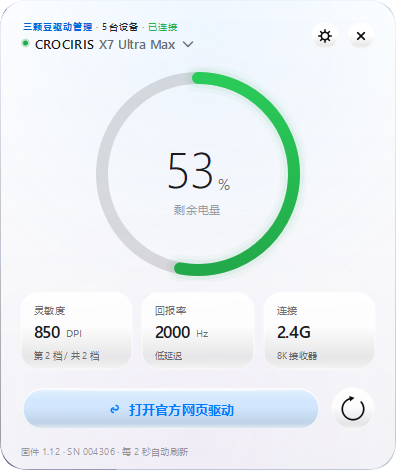
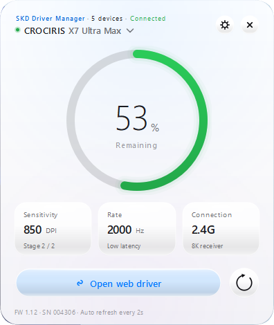
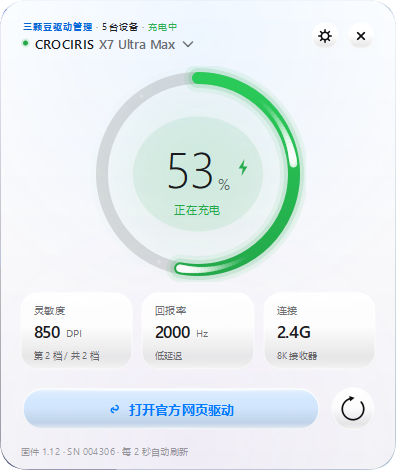
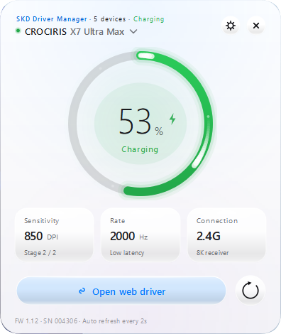
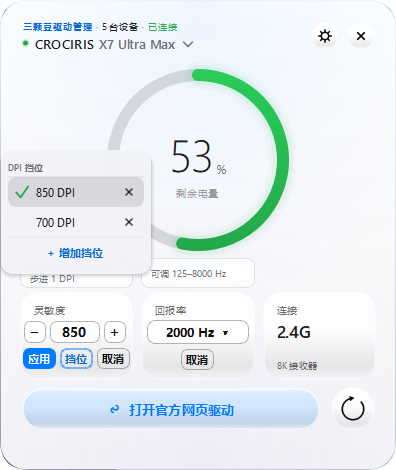
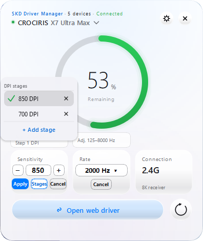
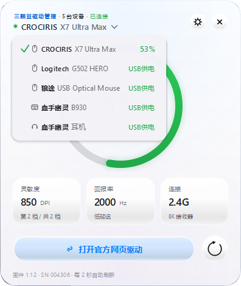
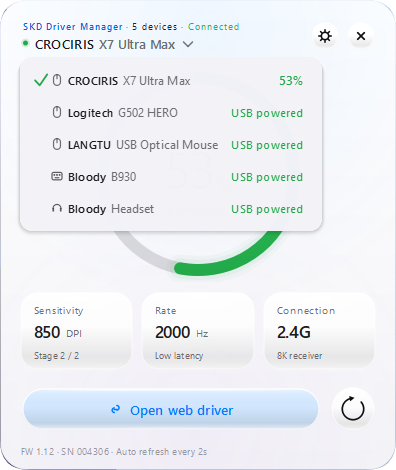
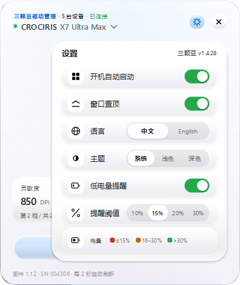
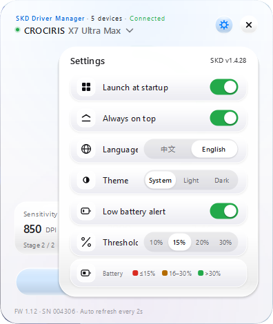

[ 简体中文](README.md) |  **English**

# Sankadou Feature Introduction

> Documentation Version: **v1.4.29**
> Supported Platforms: Windows 10 / 11 (x64), Python 3.13 + PySide6 6.9.3
> Project Mission: **Lightweight status panel and parameter management tool for multi-brand devices**. Runs in the system tray, no browser authorization required, independent of vendor web-based drivers.

---

## Let AI adapt the software to your own device!

## Instructions for local-AI capable models, copy the paragraph below:
> Fetch the source code from https://github.com/ZRX-GitHub/skdDriverTools/tree/main, read 设备适配指南.md (Device Adaptation Guide), adapt it to my device, then build the software and place it on the desktop.

## 1. What is this

Sankadou is a mini glass-style panel anchored to the bottom-right corner of the desktop. It communicates directly with devices through **Windows native HID interfaces**, displaying in real time:

- Battery level and charging status (wireless devices)
- Brand / Model / Firmware / Last six digits of the serial number
- Current DPI and profile slot (current slot / total slots)
- Polling rate (Hz) and the corresponding latency tier
- Connection method (2.4G wireless / USB wired, receiver model)

For devices that accept write commands, you can **change DPI, manage DPI profiles and switch polling-rate tiers directly inside the panel**. For devices that do not support this, the UI explicitly states *who* is handling the setting, so there are no dead buttons that do nothing when clicked.

The program starts with Windows and keeps reading data after being minimized to the tray. When several devices are plugged in, click the title bar to expand the device list and switch between them.

> Original statement (see `DESCRIPTION` in `src/setup_core.py` and the exe version info):
> "This software manages drivers for mice of various brands, including DPI, refresh rate and battery level control. **This project is open source; unauthorized commercial use is prohibited.**"

---

## 2. Feature Overview

| Category | Capability | Description |
| --- | --- | --- |
| Data acquisition | HID proprietary protocol / HID++ 2.0 / standard HID enumeration | Three independent acquisition paths run in parallel without interference. Default cadence is 2 seconds; automatically drops to about 5 seconds during sleep. |
| Battery | Circular progress ring, percentage, charging animation, low-battery notification | Thresholds 10/15/20/30% (configurable 5–50) follow the settings exactly; notifications go to the Windows Notification Center; each device is evaluated independently — reminder after a 5% drop, 30-minute fallback, 5-minute debounce. |
| DPI | Value display, profile-slot display, editable on writable devices | Writable devices support stepper input, adding/removing profiles, or profile-slot switching only. |
| Polling rate | Hz display plus latency-tier description | 125–8000 Hz split into high/medium/low latency tiers; writable devices switch tiers via a dropdown selector. |
| Connection | 2.4G / USB wired, receiver model, firmware, SN | The footer line also shows `VID:PID` to make bug reports easier. |
| Multi-device | Device list, green checkmark for the active device, fallback on disconnect, selection memory | The "N devices" label always matches the number of list rows. |
| Accessories | Keyboard / headset identification and display | Category icon plus battery text; **display only, not switchable**. |
| Appearance | System / Light / Dark themes, custom-drawn Liquid Glass | All widgets are custom-drawn, independent of native system menu styles; compact 9–12px typography. |
| Language | Full UI in Chinese / English | Translation keys are the original Chinese strings; the installer follows the OS UI language on first run and falls back to Chinese for other locales. |
| Window behavior | Docked to the bottom-right corner, always on top, collapses to tray when clicking outside | Margins are calculated in physical pixels, so 2K/4K scaling stays correct. |
| Installation | Single-file installer, no administrator rights, silent install, standalone uninstaller | Automatically creates a `skdDriver` sub-folder when a custom directory is selected. |

---

## 3. UI Tour

### 3.1 Main window (396 × 470, fixed size, not draggable)

- **Status line**: `Sankadou Driver Tools · N devices · Connected`. The software name is in brand blue, the device count in secondary gray, the connection state in green; the breathing dot on the left matches the state color. The gray hover backdrop marks both the click hot zone and the only area where the hand cursor appears.
- **Model line**: green status dot + brand (DemiBold) + model. The brand is a qualifier — when space is tight, the brand is truncated first so the model stays complete.
- **Battery ring**: circular progress plus centered percentage; while charging the whole ring turns green and shows a lightning bolt with a flowing light band. **Purely wired devices** render a full 100% green ring with green text "USB Powered" in the center and no percentage (a wired mouse has no battery, so a number would be fabricated data).
- **Three info cards**: Sensitivity / Polling Rate / Connection. Cards are read-only by default — hovering does **not** show a hand cursor or highlight; only when the current device is writable does clicking a card enter the edit module and does the right-side dropdown open the slot panel.
- **Info footer**: firmware, last six digits of the serial number, auto-refresh interval; devices without firmware/serial channels show `VID:PID XXXX:XXXX` instead.
- **Primary button**: changes with the device type — "Open official web driver" / "Open official software driver" / "No official software · Hardware-key adjustment" (disabled) / "Rescan devices" (when disconnected).










### 3.2 Device-list popup

Click the status line to expand an independent borderless floating overlay (`Qt.Tool` — not a `QMenu`, and not a child widget of the main window). It does not grab the mouse and is not redrawn away by main-window repaints.

- Each row: green checkmark (active device) + **category icon** (mouse / keyboard / headset, 12px line art) + brand (primary color) + model (secondary gray) + battery reading on the right.
- Battery text rules:
  - Purely wired → green "USB Powered"
  - Wireless with a reading → percentage colored by threshold (≤ threshold red / threshold+1 to +15 orange / above green)
  - Wireless but unreadable → gray "Unavailable"
  - Disconnected devices are not listed
- **Keyboard / headset rows `switchable=False`**: no hover backdrop, no hand cursor, clicking emits no switch signal, and the menu does not close.
- The header "N devices" is populated by row data from `main.device_menu_rows()`, so it is **always consistent** with the number of popup rows (accessories included).




### 3.3 Settings overlay

Opened from the gear icon at the top right: a standalone 312 × 386 floating card with a 150ms fade-in and 6px slide-in animation. The entire row is clickable (clicking the title is the same as toggling the switch on the right), and the hit area matches the capsule rectangle exactly.

| Option | Description |
| --- | --- |
| Launch at startup | Writes to `HKCU\...\Run` |
| Always on top | Uses Win32 `SetWindowPos` without recreating the window (so overlays are not dismissed) |
| Minimize to tray on close | Currently always enabled; the × button minimizes to the tray instead of exiting |
| Theme | System / Light / Dark (system mode is checked every 1.5 seconds) |
| Language | Chinese / English, applies immediately |
| Low-battery alerts | Master notification switch |
| Alert threshold | 10% / 15% / 20% / 30% (any value between 5 and 50 can be set in config) |
| Battery legend | Red / orange / green tiers, updated live with the threshold |

**When a purely wired device is connected**: the low-battery alert row, the threshold row and the legend at the bottom are grayed out and disabled, indicating "nothing to configure for this device".




### 3.4 Tray and context menus

- Single/double click on the tray icon: show or hide the panel; hovering shows "Model · Battery" (or "Model · USB Wired" for wired devices).
- Tray right-click: Show window / Refresh now / Open web driver / Launch at startup / Settings… / Exit.
- Window right-click: Refresh now / Open web driver / Always on top / Settings / Minimize to tray / Exit.
- Clicking outside the window automatically collapses the panel to the tray; clicking the window itself, the settings overlay or the tray popup does not collapse it accidentally.
- Notifications are registered under the AppUserModelID `Crociris.MouseGlass.1`, so this software's name and icon are shown; low-battery alerts use Windows Notification Center toasts (individually manageable under System → Notifications) and fall back to a tray balloon if delivery fails.

### 3.5 Installer

- Bilingual UI plus an in-panel language segmented control; the first install follows the OS UI language (falling back to Chinese for other locales), and upgrades keep the previously selected language.
- Default install location is `%LOCALAPPDATA%\Programs\skdDriver`, **no administrator rights required**; when a custom directory is chosen, the program itself always lands in a `skdDriver` sub-folder of that directory (choosing `D:\Apps` → `D:\Apps\skdDriver`).
- Creates Start-menu and desktop shortcuts, writes the auto-start entry and the `HKCU\...\Uninstall\MouseGlass` uninstall entry.
- Command line: `skd-setup-<version>.exe --silent --dir "D:\Apps" --lang zh`.
- The install directory contains `skdDriver.exe`, `uninstall.exe`, `app.ico` and `_internal\` (the PyInstaller onedir runtime — **do not delete or rename it**).

---

## 4. Device Support Matrix

| Device path | Identification | Connection | Power / Battery | DPI | Polling rate | Editing | Driver entry |
| --- | --- | --- | --- | --- | --- | --- | --- |
| **CROCIRIS / Siberia**<br>`MouseMonitor` | VID `36F9` (X7 / X7S / X7 Pro Max / Ultra Max, 8K receiver), VID `3554` (M7 series), proprietary usage page + `0xAA/0x55` frames | 2.4G wireless (receiver model included) | Battery percentage, charging state, sleep | Current value + profile table (up to 8 slots) | 125–8000 Hz, tiers fixed per model on the official site | **Writable**: DPI value, add/remove profiles, polling rate (`0x1A` / `0x26`) | Web driver `hub.crociris.com/connect` |
| **Logitech**<br>`LogitechMonitor` | VID `046D` + HID++ 2.0 long-report interface (`0xFF00:0x02`), verified on G502 HERO | 2.4G / USB wired | Wireless reads `0x1004/0x1000`; pure wired fixed at 100 → shows "USB Powered" | `0x2201` current value; profiles read from G HUB `settings.db` first, then onboard `0x8100` | Bitmap from `0x8060` (e.g. 125/250/500/1000) | **Probed per item**: editable only if the firmware accepts write commands; many models are managed by G HUB and read-only here | Launches local G HUB; opens the download page if not installed |
| **Unprotocoled branded mice**<br>`BrandHidMonitor` | VID/PID brand table (currently `30FA` Langtu) + standard mouse collection `0001:0002` | USB wired | No battery → "USB Powered" | Unreadable, shows `—` / "Unavailable" | Unreadable, shows `—` / "Unavailable" | **Not writable at all**: `caps.source="hw"` | Button disabled, labeled "No official software · Hardware-key adjustment" |
| **Accessories: keyboards / headsets**<br>`AccessoryMonitor` | Keyboard collection `0001:0006` + brand table; headsets via Windows audio endpoint names | USB wired | "USB Powered"; wireless without a reading shows "Unavailable" | N/A | N/A | Not shown on the main panel, listed only in the device list | None |

Hardware verified in practice:

- `36F9:AA20` X7 Receiver 8K (backs the CROCIRIS row)
- `046D:C08B` Logitech G502 HERO (pure wired)
- `30FA:0400` Langtu USB Optical Mouse (no vendor usage page, no output/feature reports)
- `09DA:FA44` Bloody B930 keyboard (model resolved from usb.ids; firmware strings are all placeholders)
- `0D8C:0012` Bloody headset (generic C-Media chip, model not resolvable, display name taken from the audio endpoint description)

---

## 5. Core Functional Details

### 5.1 Data acquisition and sleep

- One background thread per device, 2 seconds per round by default, returning thread-safe `MouseInfo` snapshots through `snapshot()`; the main window syncs the UI every 350ms.
- Once a 2.4G mouse is idle the receiver returns all-zero frames → judged "sleeping", **the last reading is kept** and the cadence drops to about 5 seconds; it returns to real time within 1–5 seconds after the mouse moves.
- The last reading is written to `cache` in `%APPDATA%\MouseGlass\config.json` and is visible immediately after a restart; `cache` is stored per device (`crociris` / `logitech` / `basic` separately) to avoid crosstalk.
- When the active device is unplugged, it temporarily yields to another online device; the selection itself is not lost, and the original device is restored automatically when replugged.

### 5.2 Battery and low-battery alerts

- Three-tier coloring: ≤ threshold red / threshold+1 to threshold+15 orange / above green; the battery ring, device-list percentages and settings legend share `theme.battery_color()`.
- Notification example: "XXX battery 30%, reached the configured 30% alert threshold, please charge in time" — the threshold comes from the settings page, and the body states both the current level and the configured value; the English UI string is `Battery 30% — reached your 30% alert threshold. Please charge.`
- **Trigger rules** (`src/lowbattery.py`): alerts only when `battery ≤ threshold`; changing the threshold or re-enabling the switch re-checks immediately; state is tracked independently per mouse; another reminder only after a further 5% drop, with a fallback reminder every 30 minutes while the battery stays low; at least 5 minutes between notifications to prevent flapping around the threshold; plugging in or rising above the threshold re-arms it automatically. A change on the active device is evaluated immediately, while other devices are covered by a 10-second poll.
- **Notification channel** (`src/notify.py`): WinRT `ToastNotificationManager` delivers standard toasts with AUMID and Tag/Group deduplication (one entry per device in the Notification Center); if notifications are disabled system-wide or delivery fails, it falls back to a tray balloon. `tools/uicheck_lowbat.py` prints channel diagnostics.
- Purely wired devices never send low-battery notifications and the tray tooltip shows "Model · USB Wired"; disconnected, sleeping, charging or unreadable-battery devices are also skipped.

### 5.3 DPI and profile editing

- **Writable devices**: clicking the sensitivity card opens the edit module — stepper input (aligned to legal steps via `DeviceCaps.align_dpi()`), a dropdown for slot selection, and a profile-management dialog (add/remove profiles, up to `MAX_DPI_STAGES`).
- Ranges come from the model specification table (`devcaps.DPI_SPECS` / `LOGITECH_SPECS`) and are then expanded with the device's real profile table, so valid steps already present on the device are not rejected as out of range.
- Logitech "profiles" must match what is configured in G HUB: read-only parsing of `%LOCALAPPDATA%\LGHUB\settings.db` comes first, then the onboard profile; if neither is available it shows "live reading" and **never pads the list with the 511-step sensor capability table**.
- The slot indicator and the value refresh in the same frame (`_calibrate_stage()` / `_level_for()`), so the number never changes before the slot does.

### 5.4 Polling rate

- Shows 125 / 250 / 500 / 1000 / 2000 / 4000 / 8000 Hz, with the latency tier labeled below as `1000/Hz`: 125–250 high latency / 500–1000 medium latency / 2000–8000 low latency.
- When writable, clicking the card enters the edit module and the dropdown opens a tier panel for selection; **values are never typed by hand**.
- When not writable, `set_pick_values([])` is called, the card is not clickable, no panel opens and no range hint is shown.

### 5.5 Uniform presentation when something is "not supported" (important)

The software never fabricates data and never offers controls that do nothing. All decisions live in `_update_edit_caps()` / `_apply_info()` / `_apply_driver()`:

| Scenario | Permanent corner badge on the card | Card subtitle | Bottom primary button | Right side of device list |
| --- | --- | --- | --- | --- |
| Values managed by G HUB (Logitech read-only) | "Supported by G HUB" | Normal reading | Open official software driver | Percentage / USB Powered |
| Values managed by other official software | "Supported by Official Software" | Normal reading | Open official web driver | Percentage / USB Powered |
| Device has no software channel (e.g. Langtu) | "Supported by Keys" → rendered as "Hardware-key adjustment" | "Unavailable" | Disabled + "No official software · Hardware-key adjustment" | "USB Powered" |
| Accessories (keyboard / headset) | Not shown on the main panel | — | — | "USB Powered" / "Unavailable" + not switchable |

The badge is a **permanent** read-only marker that appears only on modules that cannot be edited; when a badge is present the title font is reduced and the badge itself drops from 8px to 7px, so the title is never squeezed.

### 5.6 Driver entry

`src/driver.py` distinguishes three forms per device:

- `WEB` (CROCIRIS) → opens the web-driver URL in the browser (configurable via `hub_url` in `config.json`).
- `SOFTWARE` (Logitech) → locates `lghub.exe` (common directories plus the uninstall registry entry, result cached) and launches it as a `DETACHED_PROCESS`; if not installed, opens the official download page.
- `NONE` (no official software) → the button is disabled, hovering shows "This mouse has no official software; adjust DPI and polling rate with the buttons on the mouse", and clicking does nothing.

### 5.7 Appearance and language

- All widgets are custom-drawn Liquid Glass (refraction background → milky body → light band → specular highlight → inner shadow → stroke → 1px top highlight), with every gradient running only along the y-axis to avoid a "bright left, dark right" diagonal look; dark mode skips the top lighting for a matte glass finish.
- On theme switch, the settings overlay's refraction background is rebuilt from the **main-window background cache**, so the overlay never captures a snapshot of itself.
- i18n uses the original Chinese strings as keys: `i18n.T("设置")`, and a missing entry returns the Chinese string as-is (never a blank label); painted text fetches `T()` inside `paintEvent`, while text stored in widgets is explicitly retranslated when the language changes.
- The installer, main program, tray, notifications, settings, device list and error messages are all bilingual.

### 5.8 Installation, configuration and uninstallation

| Item | Location / command |
| --- | --- |
| Default install directory | `%LOCALAPPDATA%\Programs\skdDriver` |
| Configuration | `%APPDATA%\MouseGlass\config.json` (atomic writes; theme, language, threshold, device selection, cache, window position) |
| Logs | `%APPDATA%\MouseGlass\logs\app.log` |
| Auto-start | `HKCU\Software\Microsoft\Windows\CurrentVersion\Run` |
| Uninstall entry | `HKCU\Software\Microsoft\Windows\CurrentVersion\Uninstall\MouseGlass` |
| Uninstall | `uninstall.exe` in the install directory (`/quiet` for silent) / Windows "Installed apps" / `skdDriver.exe --uninstall` |

Uninstalling removes shortcuts, the auto-start entry, the registry entry and the configuration directory; `uninstall.exe` bundles its own runtime and does not depend on `_internal`.

---

## 6. Technical Overview

| Module | Responsibility |
| --- | --- |
| `src/main.py` | Main window, UI sync, edit interactions, tray, device list, low-battery scheduling |
| `src/widgets.py` | Fully custom-drawn widgets: info cards, battery ring, device menu, settings capsules, switches/segments, Liquid Glass painting |
| `src/monitor.py` | `MouseInfo` / `DeviceCaps` consumer, three acquisition paths, unified `DeviceHub` interface |
| `src/protocol.py` | CROCIRIS proprietary frames: `0xAA/0x55` packing, status frames / device info frames / profile table parsing, latency tiers |
| `src/logitech.py` / `src/ghub.py` | HID++ 2.0 feature read/write, device name/DPI/polling rate/battery, G HUB config parsing |
| `src/hid_win.py` | Windows HID enumeration, `HidCollection`, device open/read/write and presence detection |
| `src/devcaps.py` | Adjustable capability object `DeviceCaps`: range, step, slots, writability, alignment and hint text |
| `src/hidbrands.py` | VID/PID → brand / model / category table (the identification entry point for unprotocoled devices) |
| `src/accessories.py` | Keyboard / headset enumeration and construction of display-only rows, 3-second background polling |
| `src/driver.py` | Dispatches to web driver / client software / no official software per brand |
| `src/i18n.py` | Bilingual table keyed by Chinese source strings plus a formatting helper |
| `src/theme.py` / `wineffects.py` | Color palette, battery coloring, Win32 tray-popup visible border calculation |
| `src/config.py` / `applog.py` / `notify.py` / `autostart.py` | Config persistence, logging, Notification Center toasts (with tray balloon fallback), auto-start |
| `src/lowbattery.py` | Low-battery alert state machine: per-device independence, threshold tracking, recovery/upgrade/fallback/debounce |
| `src/setup_core.py` / `installer.py` / `uninstall*.py` | Install, uninstall, registry, shortcuts |
| `build.py` | Icon rendering, version info, PyInstaller packaging, version auto-increment |

Threading model: one daemon thread per collector; accessory scanning runs on its own thread (HID enumeration measured at about 240ms and must not block the title-bar click); the UI syncs only on the main thread via snapshots.

Default config values: `poll_interval=2.0`, `low_battery_threshold=15`, `close_to_tray=True`, `device="crociris"`, `language="zh"`.

---

## 7. Run from Source / Build / Test

```bash
# Dependencies
pip install -r requirements.txt       # PySide6-Essentials==6.9.3

# Run from source (Windows)
python src/main.py

# Full unit test suite
python -m unittest discover -s tests

# Build skd-setup-<version>.exe (patch number is auto-incremented and written back to setup_core.py)
python build.py
python build.py --no-bump             # Do not increment the version
python build.py --version 1.4.27      # Specify the version
```

`build.py` first renders `assets/app.ico` / `assets/uninstall.ico` and `version_info_*.txt`, then builds the main program onedir, the standalone uninstaller and the installer in order, and finally ships only `dist/skd-setup-<version>.exe` as the release artifact.

---

## 8. Known Limitations

- **Windows only**: HID enumeration, tray popups, notifications and the registry all rely on Win32 APIs.
- **Polling rate is not measured**: the displayed value is the tier reported or written to the device, not a real measured Hz sampled via Raw Input.
- **Accessories are read-only**: keyboards / headsets appear only in the device list and offer no backlight, macro or volume control.
- **Unrecognized devices are hidden**: VIDs not in the brand table are ignored — labeling an unknown brand as some other brand is worse than not showing it.
- **One receiver paired with multiple mice**: only the first detected mouse is shown for now.
- **Proprietary protocol ranges fall back to model tables**: the CROCIRIS proprietary protocol has no command to read the sensor's adjustable range, so ranges come from the union of official spec pages and the device's real profile table.
- **Multiple monitors**: the window only docks to the bottom-right of the primary display; it re-docks when monitors are added/removed or the primary display changes.

---

## 9. Open Source and Usage Restrictions

- The code and resources are provided under the rights holder's statement "**open source, unauthorized commercial use prohibited**"; **before formally publishing the repository, the rights holder must select and commit the official license text** (`LICENSE.md` in this package is a placeholder note, not a license).
- Public references used: `usb.ids` (VID/PID models), the OpenRGB device registry (B930), the public HID++ 2.0 documentation cross-checked with Solaar, and each vendor's official spec pages. All implementation code is original work by this project.
- Steps for adapting a new device are documented in the peer file **`设备适配指南.md`**; the UI design specification is in `docs/DESIGN-SYSTEM-v2.md` in this package.
